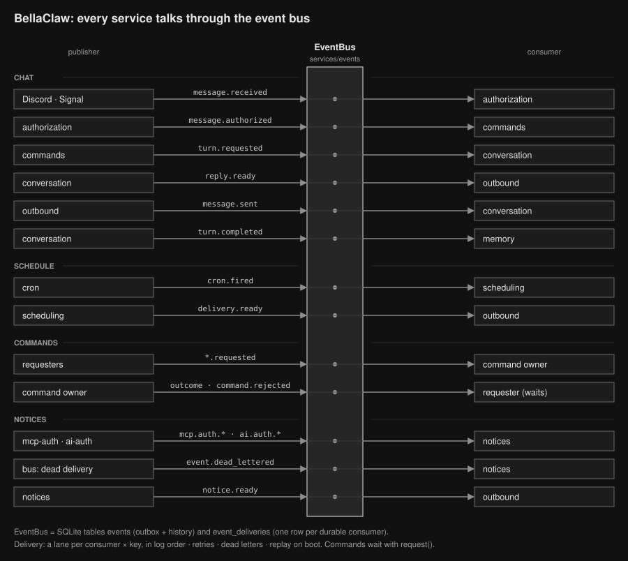

# Architecture

BellaClaw owns messaging, persistence, permissions, provider selection, credentials, limits, and
behavior logging. Pi owns model streaming, tool execution, and agent lifecycle events.

## Workspace Boundaries

BellaClaw is a Bun workspace orchestrated by Turborepo:

| Workspace | Ownership |
| --- | --- |
| `@bellaclaw/assistant` | Messaging, AI orchestration, authorization, scheduling, memory, settings, and the Turso database connection. |
| `@bellaclaw/log-viewer` | Hono routes, query parsing, assets, and behavior-log rendering. |
| `@bellaclaw/gateway` | Per-user web control panel: accounts, sessions, chat links, message history, fact graph, model and personality settings. |
| `@bellaclaw/behavior-logs` | Behavior event types, SQLite schema, read/write access, and log CLI tools. |
| `@bellaclaw/database` | Drizzle schema, the enums it stores, migrations, and drizzle-kit configs. |
| `@bellaclaw/shared` | Primitives every workspace needs: `TOption`, `AsyncQueue`, the logger, and `REPOSITORY_ROOT`. |

The apps do not import each other. The assistant and the log viewer depend on the behavior-log
package and communicate through its shared SQLite contract.

Repository-level paths (`.secrets`, hoisted `node_modules`, the default log database) resolve through
`repositoryPath()` from `@bellaclaw/shared`. Workspaces never count `../` segments to the root, so
moving a file cannot silently change which directory it reads.

## Message Flow

Services talk through one durable event log in SQLite; see the
[event architecture page](event-architecture.html) for the graph and guarantees, and
`.agents/skills/architecture/SKILL.md` for the rules when changing it.

Requesters are conversation tools, slash commands, scheduling and the internal API the gateway calls; command owners are cron, automations, memory, settings, calendar, conversation, mcp-auth and ai-auth. Reads from the allow-list (settings and authorization caches, read tools, drivers) are direct calls and are not drawn.

1. A Discord or Signal transport publishes `message.received` with a dedupe key per platform
   message. The internal API publishes a message of the app as `message.received` with channel
   `app`, keyed by its conversation, with the app's message id as the dedupe key.
2. Authorization decides activation and lockout, then publishes `message.authorized`. An app
   message skips the activation gate and passes only when the conversation belongs to the account
   the gateway verified; it leaves with the conversation's kind from the registry (Bella or
   plain).
3. Commands answers a `!command` with `reply.ready`, or publishes `turn.requested`. In a plain
   chat a `!` message is text for the model.
4. Conversation runs the turn on the chat's lane: it saves the user message with a `turn.started`
   checkpoint, runs Main (the plain agent in a plain chat, on the model the app's message named)
   with the structured replay, and commits the turn with `reply.ready` and
   `turn.completed`. Tool writes go out as commands to their owning service. Compaction runs after
   the reply is committed, and the chat's next turn starts only after it finishes.
5. Outbound sends the reply and records `message.sent`; for the app it has nothing to send and
   records it at once. A reply goes back to the channel its message came from. A reminder,
   scheduled task result or notice of an account goes to its main channel, decided at each
   attempt: the app while the account has a registered device, else its oldest linked chat, else
   the app.
   From it Conversation stores a command with
   its reply, a notice or a failure reply as display-only rows, shown in history and never
   replayed to the model; a confidential reply, such as a login link, is marked `confidential`
   and not stored. Every
   transcript change emits `conversation.changed` with the conversation's new revision and the
   revision of its latest change that was not an append (`rewriteRevision`), below which a client
   reloads instead of fetching by cursor. Memory distills facts from `turn.completed`, except a
   plain chat's, and its boot catch-up skips plain chats. The live
   consumer `app-stream` turns `conversation.changed` and the turn facts of account conversations
   into nudges and typing on the gateway's stream (see `docs/gateway.md`), and a confidential
   `reply.ready` to an app message into a `reply` the app shows once. The App
   channel's durable consumer `app` pushes the new rows of the app channel to an account with no
   open stream.
6. After a restart, unfinished deliveries replay. A turn that was interrupted mid-model gets one
   notice instead of a second model run.

Images never travel on the bus: `message.received` carries references that name their channel
and source address, and a turn fetches the bytes through that channel's attachment store. The app
uploads an image through the gateway to the internal API's media route; the App channel
(`services/app`) checks and keeps it on the assistant's data volume, lists it in `app_media`, and
serves it for download. It is the `app` attachment store for fetch and delete, so the cleanup of
images older than three compactions and a message delete remove app files too, and its durable
consumer of `conversation.deleted` removes a deleted plain chat's images, sent or only uploaded.

The App channel also owns the app's devices (`app_devices`: the id the gateway made for an app
session, the account, the FCM token and the RFC 8291 key material). Its durable consumer `app` handles
`app.device.register.requested` (answered by `app.device.registered`) and
`app.device.unregister.requested` (answered by `app.device.unregistered`, or `command.rejected`
with `device-not-found`), both on the `global` lane. The internal API unregisters every device of
an account, as a new password at the dashboard asks, with one unregister command per device. Its
live consumer `app-cache` keeps which account has a device, loaded at boot, for Outbound and for
the audience of a global notice, which also holds the Bella conversation of every account with a
device. It also keeps in memory which accounts have an
open stream at the gateway, as the gateway reports it over its live connection; a dropped
connection or a restart reads closed for every account.

The same consumer `app` sends the push. `conversation.changed` carries `messageId` when a reply,
delivery or notice appended an assistant row; a confidential reply has no row, so it has none.
When that row's channel is `app` and the account has no open stream, the consumer encrypts a
small payload (`SAppPush` in `@bellaclaw/shared`) for each of the account's devices with RFC 8291
(`services/app/web-push.ts`) and sends it to FCM HTTP v1 as a data-only message
(`services/app/fcm.ts`, with the service-account key from `BELLACLAW_FCM_CREDENTIALS_PATH`, read
only by the assistant). A token FCM no longer knows becomes an `app.device.unregister.requested`.
Any other failure is retried with the consumer's backoff; the last attempt logs and acks, so a
push never ends as a dead letter, and Notices ignores a dead `conversation.changed` anyway.

Discord and Signal use separate chat keys. Their histories and scheduled deliveries do not merge.

## Agent Runtime

Each root run and delegation creates a fresh Pi `Agent`; Pi sessions are not persisted.

Main can use web tools and delegate to:

| Specialist | Responsibility |
| --- | --- |
| Calendar | Read and manage Google Calendar events and calendar access. |
| Memory | Search and manage stored conversation facts. |
| Settings | Read and update per-chat settings. |
| Scheduling | Create, update, list, and remove reminders or recurring tasks. |
| Automations | Write, preview, save, run, pause, and delete automation scripts. |

A plain chat of the app runs the plain agent instead: web tools and the MCP profiles open to plain
chats (those that set `plainChats: true`; `vault` and `logs` stay closed), no specialists, so no
memory, calendar, scheduling, settings or automations. Conversation creates and deletes plain chats
(`conversation.create.requested`, `conversation.delete.requested`); a delete removes the chat's
transcript, summary and registry entry, and `app-stream` tells the app with `deleted`. A plain
chat's turn runs on the provider the app's message names: Main on its model and effort,
compaction on its model, and every other purpose on that provider's saved preference for it, else
its default. When the turn starts, the provider's catalog must still list the model, with the
effort, else the turn fails with a reply saying the model is no longer available instead of running
on another model. Its persona is the account's setting for plain chats
(`ai.plainChats.useBellaPersona` and `ai.plainChats.persona`): Bella's, Bella's plus the text, the
text alone, or none. After each completed turn of an untitled plain chat, the `conversation-title`
consumer of `turn.completed` makes one Utility-model call on the account's settings and Conversation stores the
title on the registry row with `conversation.changed`.

Specialists receive only role-specific tools and cannot delegate again. Scheduling can dry-run a
job with automations, which starts a scheduled-task agent run without MCP tools. Only the Memory
specialist can write conversation facts; other specialists do not write conversation memory.

## Scheduled Work

Cron jobs keep the platform-scoped chat key that created them. When a job fires, BellaClaw routes
the result back through that platform.

Scheduled-task agents can read memory, use web tools, and read calendar data. They cannot modify
calendar events, schedules, settings, or memory.

Reminder and scheduled-task output is saved to conversation memory only after successful delivery.

### Automations

An automation is a script saved per chat. It runs in a QuickJS sandbox inside a worker with memory,
CPU, time, fetch-count, and output limits. Its only access to the outside is a fetch bridge that
reaches the automation's allowed origins on public addresses.

A script returns text, data, or nothing. An automation is saved only after the user approves the
output of a preview run. Three consecutive failed runs pause it and send a notice to the chat.

A cron job can list automations to run when it fires. Without a task prompt, their text outputs are
sent as written and a failed run sends a short notice. With a task prompt, the scheduled-task agent
receives the outputs as untrusted data and writes the message.
