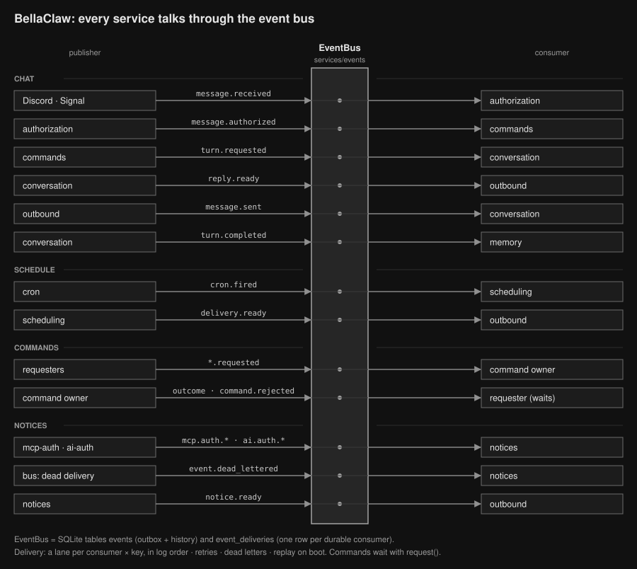

# Architecture

BellaClaw owns messaging, persistence, permissions, provider selection, credentials, limits, and
behavior logging. Pi owns model streaming, tool execution, and agent lifecycle events.

## Workspace Boundaries

BellaClaw is a Bun workspace orchestrated by Turborepo:

| Workspace | Ownership |
| --- | --- |
| `@bellaclaw/assistant` | Messaging, AI orchestration, authorization, scheduling, memory, settings, and the Turso database connection. |
| `@bellaclaw/log-viewer` | Hono routes, query parsing, assets, and behavior-log rendering. |
| `@bellaclaw/dashboard` | Per-user web control panel: accounts, sessions, chat links, message history, fact graph and model settings. |
| `@bellaclaw/behavior-logs` | Behavior event types, SQLite schema, read/write access, and log CLI tools. |
| `@bellaclaw/database` | Drizzle schema, the enums it stores, migrations, and drizzle-kit configs. |
| `@bellaclaw/shared` | Primitives every workspace needs: `TOption`, `AsyncQueue`, the logger, and `REPOSITORY_ROOT`. |

The apps do not import each other. The assistant and the log viewer depend on the behavior-log
package and communicate through its shared SQLite contract.

Repository-level paths (`.secrets`, hoisted `node_modules`, the default log database) resolve through
`repositoryPath()` from `@bellaclaw/shared`. Workspaces never count `../` segments to the root, so
moving a file cannot silently change which directory it reads.

## Message Flow

Services talk through one durable event log in SQLite; see the
[event architecture page](event-architecture.html) for the graph and guarantees, and
`.agents/skills/architecture/SKILL.md` for the rules when changing it.

Requesters are conversation tools, slash commands, scheduling and the internal API the dashboard calls; command owners are cron, automations, memory, settings, calendar, conversation, mcp-auth and ai-auth. Reads from the allow-list (settings and authorization caches, read tools, drivers) are direct calls and are not drawn.

1. A Discord or Signal transport publishes `message.received` with a dedupe key per platform
   message.
2. Authorization decides activation and lockout, then publishes `message.authorized`.
3. Commands answers a `!command` with `reply.ready`, or publishes `turn.requested`.
4. Conversation runs the turn on the chat's lane: it saves the user message with a `turn.started`
   checkpoint, runs Main with the structured replay, and commits the turn with `reply.ready` and
   `turn.completed`. Tool writes go out as commands to their owning service. Compaction runs after
   the reply is committed, and the chat's next turn starts only after it finishes.
5. Outbound sends the reply and records `message.sent`. Memory distills facts from
   `turn.completed`.
6. After a restart, unfinished deliveries replay. A turn that was interrupted mid-model gets one
   notice instead of a second model run.

Discord and Signal use separate chat keys. Their histories and scheduled deliveries do not merge.

## Agent Runtime

Each root run and delegation creates a fresh Pi `Agent`; Pi sessions are not persisted.

Main can use web tools and delegate to:

| Specialist | Responsibility |
| --- | --- |
| Calendar | Read and manage Google Calendar events and calendar access. |
| Memory | Search and manage stored conversation facts. |
| Settings | Read and update per-chat settings. |
| Scheduling | Create, update, list, and remove reminders or recurring tasks. |
| Automations | Write, preview, save, run, pause, and delete automation scripts. |

Specialists receive only role-specific tools and cannot delegate again. Scheduling can dry-run a
job with automations, which starts a scheduled-task agent run without MCP tools. Only the Memory
specialist can write conversation facts; other specialists do not write conversation memory.

## Scheduled Work

Cron jobs keep the platform-scoped chat key that created them. When a job fires, BellaClaw routes
the result back through that platform.

Scheduled-task agents can read memory, use web tools, and read calendar data. They cannot modify
calendar events, schedules, settings, or memory.

Reminder and scheduled-task output is saved to conversation memory only after successful delivery.

### Automations

An automation is a script saved per chat. It runs in a QuickJS sandbox inside a worker with memory,
CPU, time, fetch-count, and output limits. Its only access to the outside is a fetch bridge that
reaches the automation's allowed origins on public addresses.

A script returns text, data, or nothing. An automation is saved only after the user approves the
output of a preview run. Three consecutive failed runs pause it and send a notice to the chat.

A cron job can list automations to run when it fires. Without a task prompt, their text outputs are
sent as written and a failed run sends a short notice. With a task prompt, the scheduled-task agent
receives the outputs as untrusted data and writes the message.
